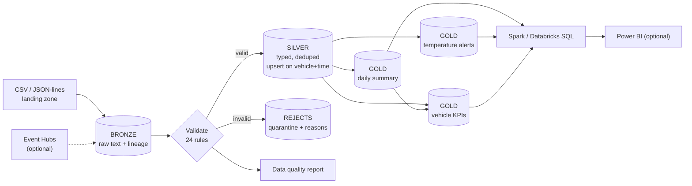

# IoT Vehicle Telemetry Data Engineering Pipeline (Azure)

[](https://github.com/himanshuupadhyay300/iot-vehicle-telemetry-pipeline/actions)


A Medallion (Bronze / Silver / Gold) pipeline that turns messy vehicle telemetry (speed, engine temperature, fuel,
battery voltage, GPS) into validated, analytics-ready datasets, with **idempotent incremental loads**, **duplicate
and late-event handling**, a **quarantine table** for bad records, and an automatic **data quality report**.

It runs fully on a laptop (PySpark + Parquet, no cloud account needed) and is structured to deploy on Azure
(ADLS Gen2, Databricks, Delta Lake, Data Factory, Event Hubs).

> **All data is synthetic.** No company or customer data is used anywhere in this repository.

---

## Contents
1. [What this project demonstrates](#1-what-this-project-demonstrates)
2. [Honest status: what is verified and what is a template](#2-honest-status)
3. [Business problem and objectives](#3-business-problem-and-objectives)
4. [Architecture](#4-architecture)
5. [Technology stack](#5-technology-stack)
6. [Repository structure](#6-repository-structure)
7. [Data schema and sample records](#7-data-schema-and-sample-records)
8. [Quick start (5 minutes, no Azure)](#8-quick-start)
9. [Pipeline workflow](#9-pipeline-workflow)
10. [Duplicates, late data and idempotency](#10-duplicates-late-data-and-idempotency)
11. [Expected output](#11-expected-output)
12. [Testing and CI](#12-testing-and-cicd)
13. [Azure deployment guide](#13-azure-deployment-guide)
14. [Performance considerations](#14-performance-considerations)
15. [Security practices](#15-security-practices)
16. [Limitations and future enhancements](#16-limitations-and-future-enhancements)
17. [Publish this repo on GitHub](#17-publish-this-repo-on-github)

---

## 1. What this project demonstrates

- **Medallion architecture** with clear contracts per layer (raw text in Bronze, typed and validated in Silver, business metrics in Gold).
- **Data quality as code**: 24 declarative rules, quarantine instead of silent drops, and a per-batch report.
- **Correctness under messy conditions**: exact and conflicting duplicates, late-arriving events, malformed lines, mixed timestamp formats.
- **Idempotent, restartable processing**: re-running changes nothing; a crash between stages resumes cleanly.
- **Engineering discipline**: typed, documented, modular code; config separated from code; structured JSON logging; custom exceptions; 68 tests; CI; no secrets in the repo.
- **Azure readiness**: Delta Lake storage path, Databricks notebooks, ADF pipeline templates, Event Hubs streaming template, Azure CLI provisioning script and an Azure DevOps pipeline.

## 2. Honest status

| Area | Status |
|---|---|
| Bronze / Silver / Gold on PySpark + Parquet (local) | **Implemented and tested** (68 tests, end-to-end run verified, 85% line coverage) |
| Data quality report + execution summary | **Implemented and tested** |
| SQL analytics (8 queries) | **Implemented, executed locally** |
| Delta Lake storage path (`--format delta`) | Implemented; has a test (`RUN_DELTA_TESTS=1`) and a non-blocking CI job. **Not executed in the environment this project was built in** (Delta jars come from Maven). Run `make delta` to verify on your machine |
| Event Hubs streaming | Event parsing is unit-tested. The streaming query is a **template, never run against Azure** |
| ADF pipeline, Databricks job/notebooks, `deploy.sh`, Azure DevOps pipeline | **Templates. Nothing was deployed** to Azure from this repo |
| Power BI | **Not implemented**; the Gold tables are shaped for it (see section 16) |

No performance numbers are claimed. The bundled sample has about 1,200 rows.

## 3. Business problem and objectives

Connected vehicles stream readings every few seconds. Raw telemetry is unreliable: sensors drop out, gateways
resend messages, networks deliver data hours late, and clocks drift. Analysts need trustworthy answers to
questions such as *Which vehicles overheated? How far did each vehicle drive today? Is data quality getting worse?*

Objectives:
1. Preserve raw data untouched for audit and replay.
2. Produce clean, de-duplicated, schema-enforced data with every rejection explained.
3. Publish Gold datasets: daily vehicle summary, temperature alerts, vehicle KPIs.
4. Make every run safe to repeat, and every late record self-correcting.

## 4. Architecture



More diagrams (incremental-run sequence, Gold data model, local-vs-Azure map) are in
[`architecture/architecture.md`](architecture/architecture.md). Trade-offs and failure modes are in
[`docs/DESIGN_DECISIONS.md`](docs/DESIGN_DECISIONS.md).

## 5. Technology stack

- **Processing:** Python 3.11+, PySpark 3.5
- **Storage:** Parquet (local default), Delta Lake (Azure target), ADLS Gen2
- **Orchestration (template):** Azure Data Factory triggering a Databricks notebook
- **Compute (template):** Azure Databricks
- **Streaming (optional template):** Azure Event Hubs via its Kafka endpoint
- **Analytics:** Spark SQL / Databricks SQL; Power BI (optional, not built)
- **Quality / DevOps:** pytest, ruff, GitHub Actions, Azure DevOps YAML

## 6. Repository structure

```
iot-vehicle-telemetry-pipeline/
├── README.md
├── requirements.txt / requirements-dev.txt / pyproject.toml
├── Makefile                      # install, test, lint, run, sql, delta, clean
├── .env.example                  # names of env vars only, no secrets
├── .gitignore
├── config/pipeline_config.yaml   # paths, rules, thresholds (no secrets)
├── data/sample/
│   ├── telemetry_batch_001.csv   # synthetic, deliberately dirty
│   ├── telemetry_batch_002.json  # synthetic JSON-lines with late + duplicate events
│   └── expected/expected_counts.json   # expectations computed by the generator
├── src/
│   ├── pipeline.py               # CLI orchestrator (Bronze -> Silver -> Gold)
│   ├── ingestion/
│   │   ├── bronze_ingest.py      # checksum-based incremental ingestion
│   │   ├── generate_synthetic_data.py
│   │   └── eventhub_stream.py    # optional streaming stage (template)
│   ├── transformations/
│   │   ├── silver.py             # typing, validation, dedupe, late flag, upsert
│   │   ├── gold.py               # daily summary, alerts, KPIs
│   │   └── dedupe.py
│   ├── validation/
│   │   ├── schema.py
│   │   ├── quality_rules.py      # declarative rules
│   │   └── quality_report.py     # JSON + Markdown reports
│   └── utils/                    # config, logging, spark session, storage, state, sql runner
├── notebooks/                    # Databricks notebooks (batch + streaming)
├── tests/                        # unit + integration tests (68)
├── sql/
│   ├── gold_queries.sql          # 8 analytical queries
│   └── databricks_create_tables.sql
├── pipelines/
│   ├── adf/                      # ADF pipeline, linked service, trigger (templates)
│   └── databricks_job.json       # Jobs API template
├── infrastructure/
│   ├── deploy.sh                 # Azure CLI provisioning (template)
│   └── azure-pipelines.yml       # Azure DevOps CI/CD (template)
├── architecture/architecture.md  # Mermaid diagrams
├── docs/DESIGN_DECISIONS.md
└── .github/workflows/ci.yml
```

## 7. Data schema and sample records

**Input contract** (CSV header or JSON keys):

| Column | Type after Silver | Rule |
|---|---|---|
| `vehicle_id` | string | required, matches `^VH-[0-9]{4}$` |
| `timestamp` | timestamp (UTC) | required, ISO-8601 or `yyyy-MM-dd HH:mm:ss`, not in the future |
| `speed_kmph` | double | required, 0 to 250 |
| `engine_temp_c` | double | required, -40 to 150 |
| `fuel_level_pct` | double | optional (missing gives a warning), 0 to 100 |
| `battery_voltage_v` | double | optional (missing gives a warning), 9 to 16 |
| `latitude`, `longitude` | double | required, valid GPS ranges |

Sample CSV rows (`data/sample/telemetry_batch_001.csv`):

```csv
vehicle_id,timestamp,speed_kmph,engine_temp_c,fuel_level_pct,battery_voltage_v,latitude,longitude
VH-0001,2026-01-05T08:00:00Z,38.93,87.4,68.09,14.11,18.526095,73.858094
VH-0001,2026-01-05T08:01:00Z,29.02,83.6,67.97,13.57,18.530361,73.859027
```

Defects deliberately injected into the sample (the generator records the expected effect of each):

- 6 exact duplicates and 2 conflicting duplicates (same key, different speed)
- 4 missing engine temperatures, 3 speeds of 400 km/h, 2 unparseable timestamps, 2 empty vehicle ids, 1 non-numeric voltage
- 5 missing fuel readings (kept, with a warning)
- 1 overheating episode on VH-0002 (5 WARNING + 5 CRITICAL readings)
- 15 VH-0001 readings withheld from batch 1 that arrive late in batch 2, plus 10 cross-batch duplicates and 1 malformed JSON line

## 8. Quick start

Requirements: Python 3.10+ and **Java 11, 17 or 21** (Spark needs a JVM). No Azure account. Built and tested locally on Python 3.12 with Java 21; the CI matrix (3.11, 3.12 with Java 17) is provided but has not run yet.

```bash
git clone https://github.com/<your-username>/iot-vehicle-telemetry-pipeline.git
cd iot-vehicle-telemetry-pipeline
python -m venv .venv && source .venv/bin/activate      # Windows: .venv\Scripts\activate
make install                                           # pip install -r requirements-dev.txt

make run      # batch 1, then batch 2 arrives (late + duplicate events)
make sql      # run the 8 analytical queries
make test     # 68 tests
```

Without `make`:

```bash
python -m src.pipeline --pattern "telemetry_batch_001.csv"   # first delivery
python -m src.pipeline                                       # picks up only the new file
python -m src.pipeline                                       # nothing new: a no-op
python -m src.utils.sql_runner sql/gold_queries.sql
```

Regenerate the sample data (deterministic): `make sample-data`. Reset everything: `make clean`.
Reports land in `output/reports/`, tables in `output/lakehouse/`.

Try Delta Lake locally (needs internet once, to fetch jars): `make delta`.

## 9. Pipeline workflow

1. **Bronze** (`bronze_ingest.py`): discover CSV/JSON files, skip any whose SHA-256 was already ingested, read everything as text, add lineage (`_batch_id`, `_ingested_at`, `_source_file`, `_row_id`), append. A CSV missing required columns fails fast with a clear error.
2. **Silver** (`silver.py`): trim and cast, evaluate every rule, split valid rows from rejects. Valid rows are de-duplicated, compared against existing Silver to flag late arrivals, then upserted on `(vehicle_id, event_ts)`. Rejects go to the quarantine table with the list of broken rules. A data quality report is written.
3. **Gold** (`gold.py`): recompute only the event dates touched by the batch.
   - `vehicle_daily_summary`: readings, speed, temperature, fuel, battery, distance (haversine), moving minutes, data-gap and GPS-jump counts
   - `temperature_alerts`: WARNING at or above 105 C, CRITICAL at or above 115 C (configurable)
   - `vehicle_kpis`: lifetime distance, active days, alert rate per 1,000 readings, low fuel/battery events
4. **State** (`state.py`): each batch records which stages finished, so a crashed run resumes where it stopped.

## 10. Duplicates, late data and idempotency

**Duplicate events.** The identity of an event is `(vehicle_id, event_ts)`. Inside a batch the latest ingested copy
wins (ties broken by file name, then row id). Against existing Silver, a matching key is an *update*, never a second
row. Conflicting duplicates (same key, different values) are counted separately in the report because they usually
indicate a device or upstream bug.

**Late-arriving events.** A new key older than that vehicle's current Silver maximum is accepted, flagged
`is_late_arrival`, and the affected day's Gold tables are recomputed. In the sample, VH-0001 is missing 15 readings
after batch 1 (Gold shows one data-gap segment); after batch 2 the gap is gone and the day's distance increases. This
is asserted by `test_late_data_corrects_gold`.

**Idempotency, three layers.**
1. Files: checksum state, so a renamed copy is skipped.
2. Silver: key-based upsert; an older ingestion never overwrites a newer one.
3. Gold and quarantine: partitions are *replaced*, not appended, so recomputation never double-counts.

Re-running the pipeline with no new files leaves every table unchanged (asserted by `test_rerun_is_a_noop`).

## 11. Expected output

Measured from the bundled data (seed 42). The numbers below are also asserted by the integration test against
`data/sample/expected/expected_counts.json`, which the data generator computes independently of the pipeline.

**After batch 1** (`telemetry_batch_001.csv`)

```
Bronze rows evaluated : 593     Valid: 581 (97.98%)    Rejected: 12 (2.02%)
Duplicate rows removed in batch: 8   Conflicting duplicate keys: 2   Late arrivals: 0
Rejections by rule: missing_engine_temp_c 4, out_of_range_speed_kmph 3, invalid_timestamp 2,
                    missing_vehicle_id 2, invalid_type_battery_voltage_v 1
Warnings          : missing_fuel_level_pct 5
Silver rows: 573    Gold daily rows: 5    Temperature alerts: 10
```

**After batch 2** (`telemetry_batch_002.json`; batch 1 is skipped by checksum)

```
Bronze 1219 | Silver 1188 | Rejects 13 | Gold daily 10 | Alerts 10 (5 WARNING + 5 CRITICAL) | KPIs 5 vehicles
Batch 2: 626 rows read, 625 valid, 1 rejected (malformed JSON line)
         15 late-arriving events, 10 already-present events updated rather than double-counted
Re-run : files_ingested=0, every table count unchanged
```

**Sample query results** (`make sql`)

Q1 fleet daily overview

| event_date | active_vehicles | readings | fleet_distance_km | fleet_moving_minutes | hottest_reading_c |
|---|---|---|---|---|---|
| 2026-01-05 | 5 | 888 | 823.83 | 849.0 | 118.0 |
| 2026-01-06 | 5 | 300 | 233.41 | 265.0 | 96.9 |

Q3 temperature alerts by vehicle and severity

| vehicle_id | severity | alerts | peak_temp_c | first_alert | last_alert |
|---|---|---|---|---|---|
| VH-0002 | CRITICAL | 5 | 118.0 | 2026-01-05 08:45:00 | 2026-01-05 08:49:00 |
| VH-0002 | WARNING | 5 | 112.0 | 2026-01-05 08:40:00 | 2026-01-05 08:44:00 |

Each run also writes `dq_report_<batch>.md/.json` and `pipeline_summary_<run>.md/.json` to `output/reports/`.
(Distances come from synthetic random-walk driving, so they illustrate the calculation, not real fleet behaviour.)

## 12. Testing and CI/CD

```bash
make test                       # everything (a few minutes, mostly Spark start-up)
pytest tests/test_quality_rules.py -q
RUN_DELTA_TESTS=1 pytest tests/test_delta.py   # Delta path (needs internet)
make lint                       # ruff
```

| Test file | What it proves |
|---|---|
| `test_quality_rules.py` | every rule fires on a minimal bad record; missing vs invalid are distinguished; optional fields only warn |
| `test_silver.py` | duplicate collapse, latest-wins, quarantine, late flag, older batches never overwrite newer, re-processing is idempotent |
| `test_gold.py` | haversine distance, gap and GPS-jump handling, alert severity boundaries, KPI maths |
| `test_bronze.py` | lineage columns, raw text preserved, renamed copy skipped, corrupt JSON line kept, missing CSV columns rejected |
| `test_storage.py`, `test_state.py`, `test_config.py` | partition replace empties stale partitions, upsert is idempotent, state persists, config validation |
| `test_streaming_parse.py` | Event Hubs payload parsing and secret handling (no Azure needed) |
| `test_pipeline_integration.py` | full batch 1, batch 2, re-run scenario against independently computed expectations |

**GitHub Actions** (`.github/workflows/ci.yml`): ruff, tests on Python 3.11 and 3.12, an end-to-end run on the sample
data that uploads the quality reports as an artifact, plus a non-blocking job for the Delta path.

**Azure DevOps** (`infrastructure/azure-pipelines.yml`, template): the same lint and test stage, then a deployment stage
that syncs the Databricks Repo and publishes the ADF pipeline using a service connection. Add an approval check on the
environment for production.

## 13. Azure deployment guide

> Everything in this section is a **template that was not executed**. Review names, regions and cost first.

1. **Provision** with `infrastructure/deploy.sh` (resource group, ADLS Gen2 with hierarchical namespace, `landing` and
   `lakehouse` containers, Key Vault, Databricks, Data Factory, optional Event Hubs, role assignment for ADF).
2. **Secrets**: store the Databricks token and any connection strings in Key Vault; create a Key Vault-backed Databricks secret scope.
3. **Databricks**: clone this repo into Repos, create a cluster, and open `notebooks/01_run_medallion_pipeline.py`. Set the
   widgets (storage account, landing/state/report paths). It switches `storage.format` to `delta` and the base path to `abfss://`.
   Use a Unity Catalog Volume for the landing, state and reports paths so both Python and Spark can reach them.
4. **Register tables** for SQL and Power BI with `sql/databricks_create_tables.sql`.
5. **Orchestrate** with ADF (`pipelines/adf/`): import the linked service (token from Key Vault), the pipeline, and the hourly
   trigger. Ingestion is idempotent, so overlapping or repeated runs are harmless. Alternatively use `pipelines/databricks_job.json`.
6. **Streaming (optional)**: create the Event Hub, store its connection string as a secret, run `notebooks/02_eventhub_streaming.py`.
7. **CI/CD**: GitHub Actions validates every change; Azure DevOps (or GitHub Actions) deploys on `main` after approval.

## 14. Performance considerations

- Silver is partitioned by `event_date`; upserts and Gold recomputation touch only affected partitions.
- Gold uses window functions per vehicle and day; a few very busy vehicles could cause skew at large scale.
- The quality metrics use several `count()` actions on cached DataFrames, which is fine at this size; a single aggregation pass would be better for very large batches.
- On Delta, schedule `OPTIMIZE ... ZORDER BY (vehicle_id, event_ts)` (included in the DDL file) and consider liquid clustering.
- Local Spark start-up dominates the runtime of the small sample, so local timings say nothing about cluster performance.

## 15. Security practices

- No credentials in code or config. `.env.example` lists variable names only; `.env` is git-ignored.
- Azure secrets come from Key Vault-backed secret scopes; ADF reads the Databricks token from Key Vault.
- Storage is private (public blob access disabled, TLS 1.2+), and ADF uses a managed identity with a least-privilege role.
- Synthetic data only, so no PII or company data can leak through the repo.
- Input is validated (schema contract, ranges, ID pattern) before it reaches Silver.
- Dependencies are pinned; CI runs on every pull request.

## 16. Limitations and future enhancements

**Known limitations**
- The state store is a JSON file: not safe for two concurrent runs, and it needs a path Python can open.
- The Parquet upsert is not atomic (Delta is). Use Delta for anything beyond local development.
- A late event for a never-seen vehicle cannot be detected (no watermark yet).
- Distance uses straight-line segments at one-minute sampling and does not cross midnight.
- Events are keyed on `(vehicle_id, event_ts)`; a real feed with message ids would use those.

**Future enhancements (not implemented)**
- Power BI report over the Gold tables (suggested pages: fleet overview, vehicle drill-down, alert timeline, data quality)
- Auto Loader for scalable file ingestion; a Delta control table instead of the JSON state file
- A "fail the run if reject rate exceeds X%" gate using `DataQualityError`
- Slowly changing vehicle dimension, Great Expectations or Delta expectations, data lineage with Unity Catalog
- Infrastructure as code (Bicep or Terraform) replacing the CLI script

## 17. Publish this repo on GitHub

```bash
git init && git add . && git commit -m "IoT vehicle telemetry medallion pipeline"
git branch -M main
git remote add origin https://github.com/<your-username>/iot-vehicle-telemetry-pipeline.git
git push -u origin main
```

Then replace `<your-username>` in this README, and add the topics `data-engineering`, `pyspark`, `delta-lake`, `azure`,
`databricks`, `medallion-architecture`. After the first green CI run, a screenshot of the quality report makes a good README image.

---

**Author:** Himanshu Upadhyay · [LinkedIn](https://linkedin.com/in/hup2000) · MIT License
