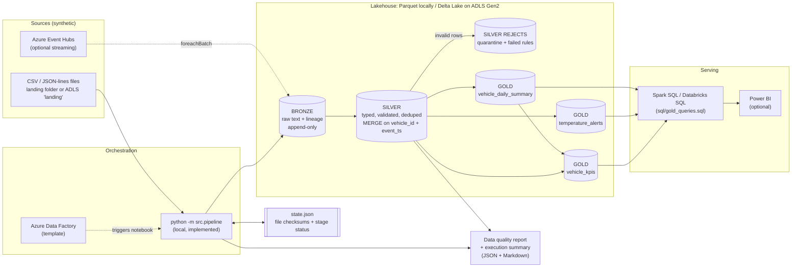
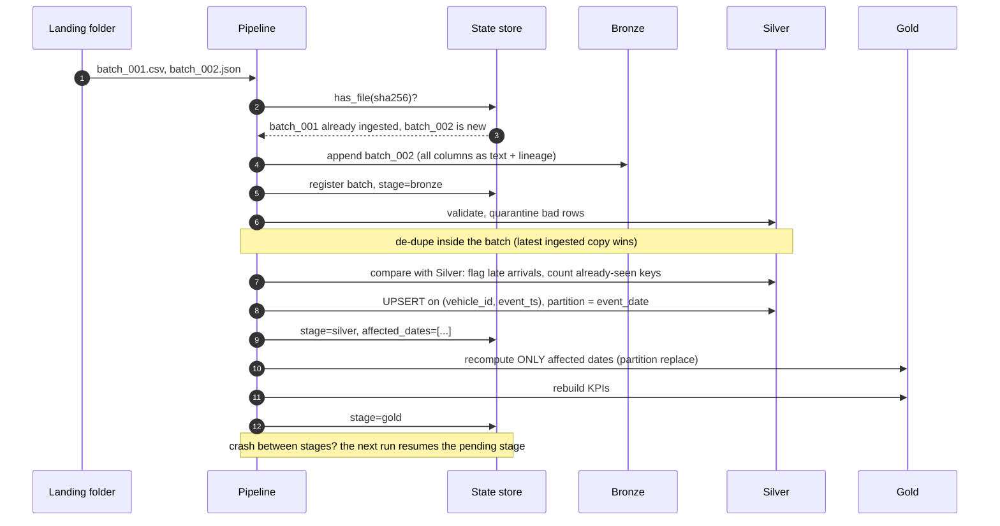
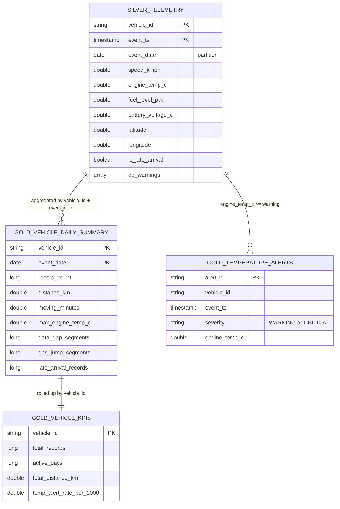

# Architecture

All diagrams are Mermaid and render natively on GitHub.

## 1. End-to-end data flow

## 2. Incremental run with late and duplicate events

## 3. Gold data model

## 4. What runs where

| Component | Local (no Azure) | Azure |
|---|---|---|
| Bronze / Silver / Gold (PySpark) | Implemented and tested | Same code, `storage.format: delta` |
| Parquet storage | Implemented and tested | n/a |
| Delta Lake storage | Implemented; needs internet for jars | Databricks runtime has Delta built in |
| Data quality + execution reports | Implemented and tested | Same |
| SQL analytics | Implemented and run locally | Databricks SQL (DDL provided) |
| ADF orchestration | n/a | Template JSON, not deployed |
| Databricks job / notebooks | n/a | Template, not executed |
| Event Hubs streaming | Parser unit-tested | Template, not executed |
| CI (GitHub Actions) | Workflow provided | n/a |
| Azure DevOps CD | n/a | Template, not executed |
